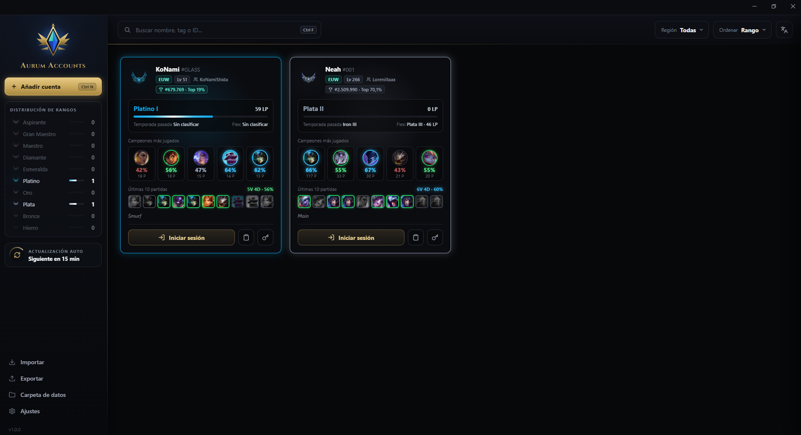

<div align="center">

# Aurum Accounts

**Gestor de cuentas de League of Legends para Windows · League of Legends account manager for Windows**

[Español](#español) · [English](#english) · [Descargar / Download](https://github.com/Dulciiss/aurum-accounts/releases/latest) · [Website](https://dulciiss.github.io/aurum-accounts)

</div>

<!-- Añade aquí una captura de pantalla de la app, por ejemplo:  -->

---

## Español

Aplicación de escritorio (Electron) para guardar todas tus cuentas de League of Legends, ver su rango de un vistazo e iniciar sesión con un clic.

### Características

- **Tarjetas de cuenta** con icono de invocador, nivel, región y rangos de **Solo/Duo** y **Flex** (con barra de LP y, si está disponible, la temporada pasada).
- **Inicio de sesión automático** en el Riot Client con un clic, en dos modos: abrir el Riot Client y escribir allí las credenciales, o escribirlas en la ventana anterior.
- **Abrir el juego** automáticamente tras iniciar sesión (opcional, en Ajustes).
- **Sincronización con el cliente de League of Legends**: detecta cada 5 segundos la cuenta activa y actualiza Riot ID, región, nivel, avatar y rango/LP cuando están disponibles. Si no está guardada, puedes importar la ficha sin credenciales y añadirlas después.
- **Rangos y estadísticas desde OP.GG**: campeones más jugados y últimas partidas. Se actualizan solos cada 15 minutos por defecto (configurable de 5 a 1440 minutos).
- **Buscar, filtrar por región y ordenar** por rango, nombre u orden manual.
- **Organizar cuentas** con etiquetas múltiples y grupos personalizados; filtra por grupos o etiquetas, y reordena manualmente con los controles de subir/bajar.
- **Vista compacta en lista** además de las tarjetas. La vista elegida se conserva al volver a abrir la aplicación.
- **Historial de Solo/Dúo** con gráfica del progreso, guardado local de hasta 180 cambios y avisos en la app o en Windows al subir o bajar de división/rango. La primera consulta establece la referencia y no genera avisos.
- **Diagnóstico seguro** desde Ajustes: copia al portapapeles un informe Markdown de versiones, arquitectura y servicios, sin nombres de cuenta, credenciales ni rutas locales.
- **Añadir cuentas** una a una o **en bloque** (`usuario:contraseña:región:RiotID#TAG`; región y Riot ID son opcionales).
- **Importar y exportar** tu lista de cuentas.
- **10 idiomas**: español, inglés, francés, alemán, portugués, ruso, turco, chino, japonés y coreano.
- Opciones de **iniciar con Windows** y **empezar minimizado**.
- **Actualizaciones automáticas**: con el instalador, la app descarga e instala las nuevas versiones desde las releases de GitHub; el Portable avisa y abre la descarga.
- Atajos: `Ctrl + N` añade una cuenta, `Ctrl + F` busca, `F11` pantalla completa.

### Instalación

1. Ve a [**Releases**](https://github.com/Dulciiss/aurum-accounts/releases/latest).
2. Descarga el **Portable** (`.exe` que se ejecuta sin instalar) o el **Setup** (instalador).
3. Ejecútalo.

**¿Cuál elegir?** El **Setup** (recomendado) se actualiza solo cuando sale una versión nueva. El **Portable** no necesita instalación, pero las actualizaciones hay que descargarlas a mano (la app te avisa).

Requiere **Windows 10/11 de 64 bits** y el **Riot Client** instalado.

> **Windows SmartScreen:** la aplicación no está firmada digitalmente, así que Windows puede mostrar el aviso *"Windows protegió su PC"*. Pulsa **Más información → Ejecutar de todos modos**. Si prefieres no fiarte de un `.exe`, puedes revisar todo el código de este repositorio y compilarlo tú mismo (ver [Desarrollo](#desarrollo)).

### Seguridad y privacidad

- **Las contraseñas se guardan cifradas** con la protección de datos de Windows (DPAPI, a través de `safeStorage` de Electron). Solo pueden descifrarse con **tu mismo usuario de Windows en este mismo equipo**.
- Los datos (`accounts.json` y `settings.json`) se guardan **en local**, en la carpeta de datos de la aplicación. Puedes abrirla desde **Ajustes → Abrir carpeta de datos**.
- La app **no envía tus credenciales a ningún servidor**: solo las escribe en el Riot Client de tu propio PC, simulando el teclado mediante PowerShell.
- La aplicación se conecta únicamente a: **OP.GG** (rangos y estadísticas), **Riot Data Dragon** y **Community Dragon** (imágenes de campeones y emblemas de rango), **GitHub** (comprobar actualizaciones) y las API locales del Riot Client (`127.0.0.1`) para abrir el juego y sincronizar la sesión activa. La sincronización consulta el cliente de League of Legends cada 5 segundos mientras está disponible.
- **Copias de seguridad:** al exportar se copia `accounts.json`, con las contraseñas cifradas para tu usuario de Windows. Si lo importas en otro equipo o usuario, tendrás que volver a introducirlas. **Importar reemplaza la lista actual de cuentas.**
- **Protección de datos:** `accounts.json` se escribe de forma segura y la app guarda una copia automática (`accounts.json.bak`). Si el archivo se daña, la app restaura la última copia buena y te avisa.
- **No subas nunca tu `accounts.json` a ningún sitio público.** Está incluido en el `.gitignore` de este proyecto.

### Desarrollo

Requisitos: [Node.js](https://nodejs.org/) (LTS) y Windows.

```bash
npm install        # instalar dependencias
npm start          # ejecutar en modo desarrollo
npm run build      # generar Portable e instalador en la carpeta dist/
```

Estructura del proyecto:

```
├── main.js              # proceso principal de Electron (ventana, cifrado de contraseñas)
├── index.html           # estructura de la interfaz
├── style.css            # estilos base
├── css/app.css          # estilos de la interfaz
├── js/app.js            # lógica de la aplicación
├── js/translations.js   # todos los textos, en los 10 idiomas
├── icon.ico · logo.svg
└── package.json
```

**Añadir un idioma:** copia un bloque de `js/translations.js`, cambia el código y traduce los valores; después añade el idioma a los desplegables de `index.html`.

**Publicar una versión (automático):**

1. Cambia `version` en `package.json` (por ejemplo `1.0.1`) y haz commit.
2. Crea y sube la etiqueta: `git tag v1.0.1` y `git push origin v1.0.1`. La etiqueta debe coincidir con `version`.
3. GitHub Actions compila en Windows y publica la release con el instalador, el Portable y `latest.yml` (el archivo que usa la actualización automática).

Los usuarios con el instalador reciben la actualización la próxima vez que la app comprueba (al arrancar y cada 6 h) o al pulsar **Ajustes → Comprobar ahora**.

**Firma de prueba para Windows (opcional):** `electron-builder` reconoce `CSC_LINK` y `CSC_KEY_PASSWORD`. Para probar la firma sin comprar un certificado, crea uno local de firma de código y exporta su clave privada a un PFX temporal:

```powershell
$cert = New-SelfSignedCertificate -Type CodeSigningCert -Subject "CN=Aurum Accounts Local Test" -CertStoreLocation "Cert:\CurrentUser\My"
$pfxPath = Join-Path $env:TEMP "aurum-accounts-test-signing.pfx"
$pfxPassword = Read-Host "Contraseña temporal del PFX" -AsSecureString
Export-PfxCertificate -Cert $cert -FilePath $pfxPath -Password $pfxPassword
$env:CSC_LINK = $pfxPath
$env:CSC_KEY_PASSWORD = [System.Net.NetworkCredential]::new("", $pfxPassword).Password
npm.cmd run build:signed
Remove-Item Env:CSC_LINK, Env:CSC_KEY_PASSWORD
Remove-Item -LiteralPath $pfxPath
Remove-Item -LiteralPath ("Cert:\CurrentUser\My\" + $cert.Thumbprint)
```

`build:signed` falla si no se proporcionan ambas variables; el certificado y el PFX no se guardan en el repositorio. Este certificado local sirve para verificar que los ejecutables quedan firmados, pero **no es de confianza para otros equipos ni elimina SmartScreen**.

Para firmar en el flujo de releases con un certificado PFX, configura los secretos `WINDOWS_CSC_CERTIFICATE_BASE64` (contenido del PFX codificado en Base64) y `WINDOWS_CSC_KEY_PASSWORD` en GitHub Actions. Se puede generar el valor Base64 en PowerShell con `[Convert]::ToBase64String([System.IO.File]::ReadAllBytes("<ruta-al-pfx>"))`; el workflow restaura el PFX en el directorio temporal del runner, lo pasa a electron-builder mediante `CSC_LINK`/`CSC_KEY_PASSWORD` y lo elimina después de compilar. Sin esos secretos, la release se genera sin firmar. **No uses un certificado local de prueba como certificado de publicación.**

**WinGet:** los manifiestos versionados para la release existente `1.0.1` están en [`manifests/d/Dulciiss/AurumAccounts/1.0.1`](./manifests/d/Dulciiss/AurumAccounts/1.0.1). El hash SHA-256 está calculado contra el instalador publicado en GitHub. Para enviarlos, copia esa carpeta al mismo directorio de tu fork de `microsoft/winget-pkgs`, valida el manifiesto con `winget validate --manifest <ruta-a-la-carpeta>` y abre un pull request. Para cada versión, actualiza la carpeta y los manifiestos, publica primero el instalador en GitHub Releases y vuelve a calcular `InstallerSha256` desde ese archivo exacto; no reutilices el hash ni la URL de una versión anterior.

### Aviso legal

Aurum Accounts es un proyecto de la comunidad. **No está respaldado por Riot Games** y no refleja las opiniones de Riot Games ni de nadie que participe oficialmente en la producción o gestión de sus propiedades. Riot Games, League of Legends y todas las propiedades asociadas son marcas comerciales o marcas registradas de Riot Games, Inc. **No está afiliado a OP.GG.** Úsalo bajo tu propia responsabilidad.

### Licencia

[MIT](LICENSE) © Dulciiss

---

## English

A desktop app (Electron) to keep all your League of Legends accounts in one place, see their ranks at a glance and sign in with one click.

### Features

- **Account cards** with summoner icon, level, region and **Solo/Duo** and **Flex** ranks (with LP bar and, when available, last season's rank).
- **Automatic sign-in** to the Riot Client with one click, in two modes: open the Riot Client and type the credentials there, or type them into the previous window.
- **Launch the game** automatically after signing in (optional, in Settings).
- **League of Legends client sync**: checks every 5 seconds for the active account and updates its Riot ID, region, level, avatar and rank/LP when available. If it is not saved, you can import a profile without credentials and add them later.
- **Ranks and stats from OP.GG**: most played champions and recent games. They refresh automatically every 15 minutes by default (configurable from 5 to 1440 minutes).
- **Search, filter by region and sort** by rank, name or manual order.
- **Organize accounts** with multiple tags and custom groups; filter by groups or tags and manually reorder accounts with the move up/down controls.
- **Compact list view** alongside the card grid. The selected view is restored when the app is reopened.
- **Solo/Duo rank history** with a progress chart, up to 180 saved changes and in-app or Windows alerts when a division/tier changes. The first reading sets the baseline without an alert.
- **Privacy-safe diagnostics** in Settings: copies a Markdown report of app/system versions, architecture and service status without account names, credentials or local paths.
- **Add accounts** one by one or **in bulk** (`username:password:region:RiotID#TAG`; region and Riot ID are optional).
- **Import and export** your account list.
- **10 languages**: Spanish, English, French, German, Portuguese, Russian, Turkish, Chinese, Japanese and Korean.
- **Start with Windows** and **start minimized** options.
- **Automatic updates**: with the installer, the app downloads and installs new versions from GitHub releases; the Portable build notifies you and opens the download.
- Shortcuts: `Ctrl + N` adds an account, `Ctrl + F` searches, `F11` toggles full screen.

### Installation

1. Go to [**Releases**](https://github.com/Dulciiss/aurum-accounts/releases/latest).
2. Download the **Portable** build (a `.exe` that runs without installing) or the **Setup** installer.
3. Run it.

**Which one?** The **Setup** (recommended) updates itself whenever a new version is out. The **Portable** build needs no installation, but updates must be downloaded by hand (the app notifies you).

Requires **64-bit Windows 10/11** and the **Riot Client** installed.

> **Windows SmartScreen:** the app is not digitally signed, so Windows may show a *"Windows protected your PC"* warning. Click **More info → Run anyway**. If you'd rather not trust an `.exe`, you can read all the code in this repository and build it yourself (see [Development](#development)).

### Security and privacy

- **Passwords are stored encrypted** using Windows data protection (DPAPI, through Electron's `safeStorage`). They can only be decrypted by **the same Windows user on the same computer**.
- Data (`accounts.json` and `settings.json`) is stored **locally**, in the app's data folder. You can open it from **Settings → Open data folder**.
- The app **does not send your credentials to any server**: it only types them into the Riot Client on your own PC, simulating the keyboard through PowerShell.
- The app only connects to: **OP.GG** (ranks and stats), **Riot Data Dragon** and **Community Dragon** (champion images and rank emblems), **GitHub** (update checks) and the Riot Client's own local APIs (`127.0.0.1`) to launch the game and sync the active session. Sync polls the League of Legends client every 5 seconds while it is available.
- **Backups:** exporting copies `accounts.json`, with passwords encrypted for your Windows user. If you import it on another computer or user, you will need to enter them again. **Importing replaces the current account list.**
- **Data protection:** `accounts.json` is written safely and the app keeps an automatic backup (`accounts.json.bak`). If the file gets corrupted, the app restores the last good copy and lets you know.
- **Never upload your `accounts.json` anywhere public.** It is already listed in this project's `.gitignore`.

### Development

Requirements: [Node.js](https://nodejs.org/) (LTS) and Windows.

```bash
npm install        # install dependencies
npm start          # run in development mode
npm run build      # build the Portable and installer into dist/
```

Project structure:

```
├── main.js              # Electron main process (window, password encryption)
├── index.html           # UI structure
├── style.css            # base styles
├── css/app.css          # UI styles
├── js/app.js            # application logic
├── js/translations.js   # all texts, in the 10 languages
├── icon.ico · logo.svg
└── package.json
```

**Adding a language:** copy a block in `js/translations.js`, change the code and translate the values; then add the language to the dropdowns in `index.html`.

**Publishing a version (automatic):**

1. Change `version` in `package.json` (for example `1.0.1`) and commit.
2. Create and push the tag: `git tag v1.0.1` and `git push origin v1.0.1`. The tag must match `version`.
3. GitHub Actions builds on Windows and publishes the release with the installer, the Portable build and `latest.yml` (the file the automatic update relies on).

Users with the installer get the update the next time the app checks (on startup and every 6 h) or when they press **Settings → Check now**.

**Optional Windows test signing:** `electron-builder` recognizes `CSC_LINK` and `CSC_KEY_PASSWORD`. To test signing without purchasing a certificate, create a local code-signing certificate and export its private key to a temporary PFX:

```powershell
$cert = New-SelfSignedCertificate -Type CodeSigningCert -Subject "CN=Aurum Accounts Local Test" -CertStoreLocation "Cert:\CurrentUser\My"
$pfxPath = Join-Path $env:TEMP "aurum-accounts-test-signing.pfx"
$pfxPassword = Read-Host "Temporary PFX password" -AsSecureString
Export-PfxCertificate -Cert $cert -FilePath $pfxPath -Password $pfxPassword
$env:CSC_LINK = $pfxPath
$env:CSC_KEY_PASSWORD = [System.Net.NetworkCredential]::new("", $pfxPassword).Password
npm.cmd run build:signed
Remove-Item Env:CSC_LINK, Env:CSC_KEY_PASSWORD
Remove-Item -LiteralPath $pfxPath
Remove-Item -LiteralPath ("Cert:\CurrentUser\My\" + $cert.Thumbprint)
```

`build:signed` fails unless both variables are set; the certificate and PFX are not stored in the repository. This local certificate verifies that the executables are signed, but **is not trusted on other computers and does not remove SmartScreen warnings**.

To sign release builds with a PFX, configure the GitHub Actions secrets `WINDOWS_CSC_CERTIFICATE_BASE64` (Base64-encoded PFX contents) and `WINDOWS_CSC_KEY_PASSWORD`. Generate the Base64 value in PowerShell with `[Convert]::ToBase64String([System.IO.File]::ReadAllBytes("<path-to-pfx>"))`; the workflow restores the PFX in the runner's temporary directory, passes it to electron-builder as `CSC_LINK`/`CSC_KEY_PASSWORD`, then deletes it. Without those secrets, releases remain unsigned. **Do not use a local test certificate for publishing.**

**WinGet:** versioned manifests for the existing `1.0.1` release are in [`manifests/d/Dulciiss/AurumAccounts/1.0.1`](./manifests/d/Dulciiss/AurumAccounts/1.0.1). The SHA-256 was calculated from the installer published on GitHub. To submit, copy this directory into the same path in a fork of `microsoft/winget-pkgs`, validate it with `winget validate --manifest <path-to-directory>`, and open a pull request. For each new version, update the directory and manifests, publish the installer to GitHub Releases first, and recalculate `InstallerSha256` from that exact file; never reuse an old version's hash or URL.

### Disclaimer

Aurum Accounts is a community project. It is **not endorsed by Riot Games** and does not reflect the views or opinions of Riot Games or anyone officially involved in producing or managing Riot Games properties. Riot Games, League of Legends and all associated properties are trademarks or registered trademarks of Riot Games, Inc. **It is not affiliated with OP.GG.** Use it at your own risk.

### License

[MIT](LICENSE) © Dulciiss
